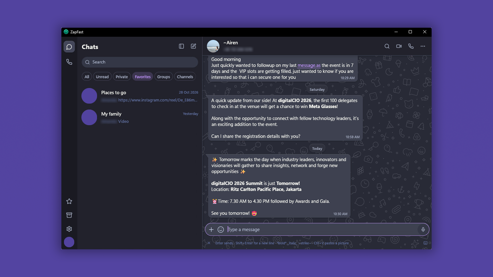
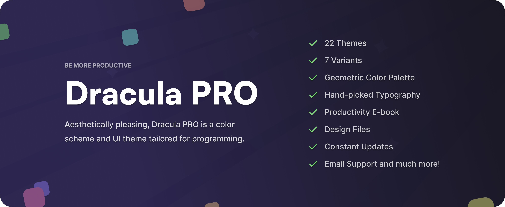

# Dracula for [ZapFast](https://zapfast.rocks)

> A dark theme for [ZapFast](https://zapfast.rocks), the fast, open-source desktop WhatsApp client.

Includes both variants:

- **Dracula** (`Dracula.json`) - the classic dark theme
- **Alucard** (`Alucard.json`) - the light variant

## Install

All instructions can be found at [draculatheme.com/zapfast](https://draculatheme.com/zapfast), or in [INSTALL.md](./INSTALL.md).

## Team

This theme is maintained by the following person(s) and a bunch of [awesome contributors](https://github.com/edwinkrisnha/dracula-zapfast/graphs/contributors).

|  |
| ------------------------------------------------------------------------------------------------- |
| [Edwin Krisnha](https://github.com/edwinkrisnha)                                                  |

## Community

Join thousands of vampires using Dracula Theme around the world 🦇

- [X (Twitter)](https://x.com/draculatheme) and [Instagram](https://www.instagram.com/draculatheme) - Follow for tips, news, and fun.
- [Discord](https://draculatheme.com/discord-invite) - Hang out and chat with the rest of the clan.
- [GitHub Discussions](https://github.com/dracula/dracula-theme/discussions) - Ask questions and discuss issues.

## Dracula PRO

## License

[MIT License](./LICENSE)
